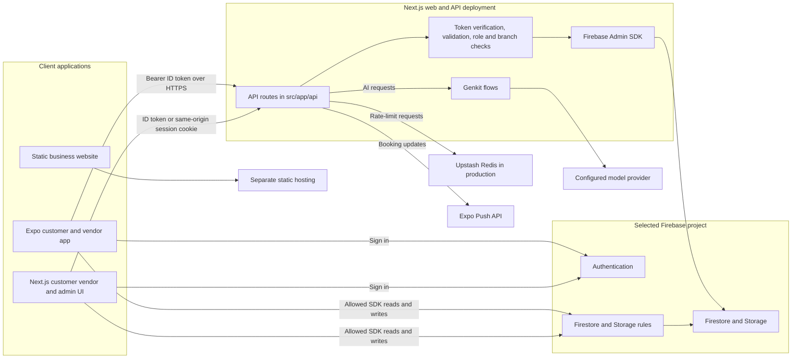

# QarWheel current architecture

Updated: 2026-11-11. [The module map](module-map.md) is the primary file-navigation index. This document records current dependencies; it does not require moving executable roots or creating separate services.

## Three application boundaries

| Release unit | User-facing areas | Depends on |
| --- | --- | --- |
| Business website | Company/product information, EN/AR | Local static assets and Python build; no application backend |
| Web platform | Customer, vendor, master-admin and public app pages | Next.js, shared backend, Firebase and generated tokens |
| Mobile platform | Customer and vendor | Expo, shared API, Firebase and generated tokens |

The six principal experiences share three codebases. Web roles use separate route/layout/permission areas within one Next.js app. Mobile roles use separate screens/guards within one Expo app. Their existing routes and installed application identifiers are preserved.

## Runtime connection map

This is a code-level diagram, not a claim that the staging or production services have been deployed and connected.



There is **no separate Express server or Firebase Functions service**. The backend is the Next.js API in the web deployment. Mobile never imports server code at runtime: `mobile/lib/api.ts` calls the configured `EXPO_PUBLIC_API_BASE_URL`, and `mobile/lib/firebase.ts` initializes its own Firebase client SDK. Both clients must use the intended Firebase project. The static business website neither owns the API nor reads the application database.

### Which path owns the data?

| Data or action | Mobile connection | Authority and durability |
| --- | --- | --- |
| Sign-in and role claims | Firebase Authentication | Firebase issues the ID token; API handlers and rules enforce access independently of mobile navigation |
| Listed branches, active services, vehicles and live booking views | Firebase client SDK | Firestore is shared across devices; `firestore.rules` controls client access |
| Booking creation, quote acceptance and vendor status progression | `mobile/lib/api.ts` to Next.js API | Server validates identity, scope and lifecycle, then writes Firestore using Firebase Admin SDK |
| Vendor invoices, staff and onboarding | Next.js vendor API routes | Server validates business/branch scope and owns the privileged write |
| Theme, cached UI state and some vendor management/wallet-like records | Zustand persisted in AsyncStorage | Device-local only; not a shared business ledger, payment record or reliable cross-device backup |

The client SDK and the API are **two paths to the same Firebase project**, not two databases. Firebase Admin SDK bypasses Firestore client rules; this is why every privileged API handler needs its own authorization checks. Conversely, a client-side role guard is navigation only and cannot replace either server checks or rules.

### Mobile layers

1. `mobile/app/_layout.tsx` initializes error reporting, authentication, query caching, navigation guards, biometric and unavailable-feature gates, connectivity feedback and push deep links. Customer routes live in `mobile/app/(tabs)/`; vendor routes and their scoped booking/branch providers live in `mobile/app/vendor/`.
2. `mobile/lib/AuthContext.tsx` observes Firebase ID-token changes and projects role, business and branch claims for navigation and queries. Native Firebase auth persistence is configured in `mobile/lib/auth-persistence.native.ts`. These client checks are not authorization.
3. `mobile/lib/firestoreOps.ts`, `marketplace-source.ts` and `vendorQueries.ts` read allowed Firestore documents directly. Customer bookings initially load a bounded page; vendor booking and listed-branch listeners are still unbounded. Firebase rules, not the UI, authorize these reads and permitted writes.
4. `mobile/lib/api.ts` attaches a Firebase bearer token to privileged HTTP requests. `mobile/lib/store.ts` persists selected Zustand state in AsyncStorage, including some local business and wallet-like records. That state is device-local and must not be treated as a server ledger or shared source of truth.

### Backend layers

1. `src/app/api/` contains the HTTP handlers. `src/lib/firebase-auth.ts` verifies Firebase ID-token signatures, issuer, audience and expiry from either a bearer header or the web session cookie.
2. Handlers validate payloads, enforce roles and business/branch scope through `src/lib/auth/require-role.ts` and related permissions, and rate-limit through `src/lib/rate-limit.ts`. Production requires configured Upstash Redis; local development can use an in-process limiter.
3. `src/lib/firebase-admin.ts` gives authorized handlers server access to Firebase. Admin writes bypass Firestore rules, so handlers must verify ownership, relationships and state transitions themselves. Client SDK writes remain constrained by root `firestore.rules` and `storage.rules`.
4. AI handlers call `src/ai/flows/` through Genkit. Booking transitions can send best-effort notifications through `src/lib/push.ts`; push delivery failure does not roll back a successful booking change.

## Booking and service flow

```mermaid
sequenceDiagram
  participant Customer as Customer mobile
  participant Auth as Firebase Auth
  participant API as Next.js API
  participant DB as Firestore
  participant Vendor as Vendor mobile
  Customer->>Auth: Sign in and receive ID token
  Customer->>API: POST /api/bookings with token and idempotency key
  API->>DB: Transaction checks owned car, listed branch, active service and business
  API->>DB: Create Pending booking and return stable booking ID
  DB-->>Vendor: Scoped booking listener receives request
  Vendor->>API: POST /api/bookings/:id/quote with offer and revision
  API->>DB: Store Offered quote
  DB-->>Customer: Booking listener shows quote
  Customer->>API: Accept current quote revision
  API->>DB: Mark quote Accepted and booking Confirmed
  Vendor->>API: POST /api/bookings/:id/transition
  API->>DB: Validate role and transition; append status history
  API-->>Customer: Best-effort Expo push on status change
```

Booking creation and quote acceptance are server-owned. The creation endpoint derives customer identity and booking status, checks the selected car/service/branch/business and makes retries idempotent. Direct client booking creation is denied by Firestore rules. The web customer booking page also calls `POST /api/bookings`; the quote offer/accept UI shown above is wired in the mobile `BookingQuotePanel`, not established here as a web UI flow. Vendor mobile progression calls the transition endpoint; permitted direct client operations still exist, including customer cancellation through a Firestore transaction. A successful write updates live listeners, so the other app can refresh without a second application server. Completion is **not** a payment event: the first-release policy is pay at garage, with no verified online settlement or payout flow.

| Service | Current owner and path | Boundary |
| --- | --- | --- |
| Identity and roles | Firebase Auth; `src/lib/auth/`, `mobile/lib/AuthContext.tsx` | Signed token plus server/rule authorization; client navigation is advisory |
| Garage discovery and customer vehicles | Firebase client SDK; `mobile/lib/marketplace-source.ts`, `firestoreOps.ts` | Listed/scoped queries and Firestore rules |
| Bookings and quotes | `src/app/api/bookings/`, mobile `firestoreOps.ts` and `vendorOps.ts` | Server-owned creation, quote and vendor transitions; live Firestore reads |
| Vendor onboarding, staff and invoices | `src/app/api/vendor/` | Authenticated business/branch checks and server writes |
| Administrator operations | `src/app/api/admin/` | Master-admin checks and privileged server writes |
| Conversations and notifications | Firestore client paths; `src/lib/push.ts`, `mobile/lib/notifications.ts` | Scoped messages; push is asynchronous best effort |
| AI diagnosis, maintenance, VIN and insights | `src/app/api/ai/` to `src/ai/flows/` | Authenticated/rate-limited server calls; model keys stay server-side |
| Maps, biometric unlock and BLE | Native modules under `mobile/lib/` and mobile screens | Device capabilities; they are not separate backend services |

To trace a mobile action in code:

| User action | Client function/component | Next hop and result |
| --- | --- | --- |
| Browse garages | `marketplaceSource.subscribe`, `fetchMarketplaceServices` | Firestore `branches` and `branch_services` through client rules; no API request |
| View own bookings | `useFirestoreBookings` | Scoped Firestore listener on `bookings` |
| Request a booking | `BookingComposer` -> `firestoreOps.createBooking` -> `apiPost` | `POST /api/bookings` validates and creates the booking |
| Offer or accept a quote | `BookingQuotePanel.submit` -> `apiPost` | `POST /api/bookings/:id/quote` validates revision, role and ownership |
| Progress a vendor job | `vendorOps.advanceBookingStatus` -> `apiPost` | `POST /api/bookings/:id/transition` updates status/history and attempts push |
| Assign staff to a job | Vendor assignment picker -> `vendorOps.assignBookingStaff` | `POST /api/bookings/:id/assignment` validates active membership and branch; direct client assignment is denied |
| Create a vendor invoice | `billing.createInvoice` -> `apiPost` | `POST /api/vendor/invoices` checks business/branch and booking amount |

See [the current data map](production-data-architecture.md) for collection ownership and [the mobile release gates](../mobile/MOBILE-RELEASE-GATES.md) for capability and device limitations. Routes listed in `mobile/lib/feature-availability.ts` are intentionally gated because their corresponding backend contracts do not exist; a screen file alone is not an implemented service.

## Configuration and deployment contract

| Runtime | Required connection | Deployment boundary |
| --- | --- | --- |
| Mobile build | `EXPO_PUBLIC_API_BASE_URL` is the HTTPS origin of the Next.js API host, with no `/api` suffix; `EXPO_PUBLIC_FIREBASE_*` selects the same intended Firebase project | Expo/EAS binary or export; a main Git push does not install a mobile update |
| Web build | `NEXT_PUBLIC_APP_URL` and `NEXT_PUBLIC_FIREBASE_*` select its HTTPS origin and Firebase project | Next.js build and Firebase App Hosting backend; Cloudflare/OpenNext remains an alternative |
| API runtime | Firebase Admin identity, Redis limiter, AI model key and cron secret are server-only | Same Next.js deployment as the web UI; never bundle these values under `EXPO_PUBLIC_*` or `NEXT_PUBLIC_*` |
| Firebase policies | Root `firebase.json`, rules, Storage rules and indexes | Deploy separately from client binaries; install required indexes before dependent queries |

`apphosting.yaml` selects managed Firebase credentials for the primary host and currently caps instances at one; `apphosting.staging.yaml` and `apphosting.production.yaml` label the intended environment. These files do not provision a Firebase project, grant IAM, configure a scheduler or demonstrate capacity. Use the [web release check](firebase-app-hosting.md) and [mobile release check](../mobile/MOBILE-RELEASE-GATES.md) with matching environment files, then test a deployed staging customer/vendor journey and native devices. The core mobile API uses `EXPO_PUBLIC_API_BASE_URL`; `EXPO_PUBLIC_BACKEND_URL` belongs to legacy, gated integrations and is not a second required backend for the first release.

## Stable source boundaries

- `src/app/dashboard/`, `vendor/`, `admin/`: role-specific web routes.
- `src/components/`: role-specific and shared web UI.
- `src/app/api/`: HTTP backend built and deployed with Next.js.
- `src/lib/`: shared web utilities and server modules; server credentials stay out of client imports.
- `src/firebase/`: web client SDK integration.
- `src/ai/`: server flows invoked by APIs; the optional Genkit development UI is not a production service.
- `mobile/`: Expo project containing both mobile experiences, tracked in this repository.
- `QarWheel-Unified-Website/`: maintained static website, with separate source and generated output.
- `packages/tokens/`: source for committed generated web/mobile tokens.
- Root Firebase policy/config: shared data access boundary, kept at existing paths.
- `archive/`: preserved older websites and extracted third-party reference material.

Generated `.next/`, `out/`, Expo/export folders, logs and ZIPs are artifacts, not extra systems. The retained root Android project and generated mobile native projects are not moved or renamed; their differing application identifiers require release-owner review.

## Shared backend and database

The platform uses a hybrid data path. Clients subscribe to and modify data permitted by Firebase rules; privileged operations call authenticated Next.js APIs. Keep both paths aligned rather than rewriting working reads simply to match a folder diagram.

The backend covers booking creation/quotes/transitions, vendor registration/KYC/staff/invoices, administration, account deletion and AI requests. Firebase supplies Authentication, Firestore and Storage. No separate Express, SQL or Firebase Functions deployment is configured here.

Identity, business/branch scope and state validation belong in server routes and Firebase rules. Client guards only control navigation. See [the current data map](production-data-architecture.md). No database migration is part of segregation.

## Git and dependency boundaries

The main repository now contains the earlier mobile history under `mobile/`. Web and mobile retain separate lockfiles and npm dependencies; root CI verifies both. A main push includes mobile source but does not itself publish a store binary. Generated token files are `src/app/tokens.generated.css` and `mobile/lib/theme.generated.ts`; update them together with `npm run tokens:build`.

Keep Next.js and React Native dependency sets independent. Neither a new workspace framework nor a dependency upgrade is necessary to organize file ownership. `systems.json` and `qarwheel.code-workspace` describe locations and do not run the application.

## Hosting and environments

Firebase App Hosting is the selected primary web/API host. Cloudflare/OpenNext is an explicit alternate. [Firebase setup](firebase-app-hosting.md) records environment/secret configuration and managed server identity; actual backend/project IDs and domains still need confirmation. The business website can use static hosting; it cannot serve the application APIs.

Web, mobile and server must target the same intended environment. Public configuration is bundled into clients. Secret values, IAM grants and hosted connectivity are separate from checked configuration. Distributed rate limiting, expiry scheduling, monitoring, backup and recovery need operational ownership.

## Capability boundaries

Implemented screens do not prove complete services. Some mobile management remains local-only; missing-backend features are gated. Provider email delivery and online payments/payouts are unfinished; the release policy is pay at garage. An invoice or completed booking does not prove money settlement.

Use existing role, booking, quote, invoice and tenancy tests, followed by a deployed staging journey and physical-device checks. Retain feature gates until their backend/provider and failure paths are accepted. Do not create payment, dispatch, insurance or AI services as part of folder organization.

## Release compatibility

Release compatible API support and indexes before dependent clients. Handle older installed mobile versions before incompatible rules: current rules deny direct booking creation, while older clients may still attempt it. Keep recorded code/rule artifacts and preserve API support during rollback. Do not relax authorization or restore data as an ordinary code rollback.

See [the runbook](production-runbook.md) for checks. Historical plans in `docs/architecture/` are proposals; current source and acceptance evidence take precedence.
